Nuxt provides a few utilities to work with [Nuxt modules](/modules) seamlessly.

## `nuxt module add`

<!--module-add-cmd-->
```bash [Terminal]
npx nuxt module add <MODULENAME...> [--cwd=<directory>] [--logLevel=<silent|info|verbose>] [--skipInstall] [--skipConfig] [--dev] [--packageManager=<npm|pnpm|yarn|bun|deno|aube|nub|upm>]
```
<!--/module-add-cmd-->

### Arguments

<!--module-add-args-->
| Argument        | Description                                                         |
|-----------------|---------------------------------------------------------------------|
| `MODULENAME...` | Specify one or more modules to install by name, separated by spaces |
<!--/module-add-args-->

### Options

<!--module-add-opts-->
| Option                                                          | Default | Description                                     |
|-----------------------------------------------------------------|---------|-------------------------------------------------|
| `--cwd=<directory>`                                             | `.`     | Specify the root directory of your Nuxt project |
| `--logLevel=<silent\|info\|verbose>`                            |         | Specify build-time log level                    |
| `--skipInstall`                                                 |         | Skip npm install                                |
| `--skipConfig`                                                  |         | Skip nuxt.config.ts update                      |
| `--dev`                                                         |         | Install modules as dev dependencies             |
| `--packageManager=<npm\|pnpm\|yarn\|bun\|deno\|aube\|nub\|upm>` |         | Package manager to install with                 |
<!--/module-add-opts-->

The command lets you install [Nuxt modules](/modules) in your application with no manual work.

When running the command, it will:

- install the module as a dependency using your package manager
- add it to your [package.json](/docs/directory-structure/package) file
- update your [`nuxt.config`](/docs/directory-structure/nuxt-config) file

**Example:**

Installing the [`Pinia`](/modules/pinia) module

```bash [Terminal]
npx nuxt module add pinia
```

Run it without a module name to pick from the modules compatible with your Nuxt version.

::note
[`nuxt add`](/docs/api/commands/add) is the same command, and also accepts layers.
::

## `nuxt module remove`

<!--module-remove-cmd-->
```bash [Terminal]
npx nuxt module remove [MODULENAME...] [--cwd=<directory>] [--logLevel=<silent|info|verbose>] [--skipInstall] [--skipConfig]
```
<!--/module-remove-cmd-->

### Arguments

<!--module-remove-args-->
| Argument        | Description                                                        |
|-----------------|--------------------------------------------------------------------|
| `MODULENAME...` | Specify one or more modules to remove by name, separated by spaces |
<!--/module-remove-args-->

### Options

<!--module-remove-opts-->
| Option                               | Default | Description                                     |
|--------------------------------------|---------|-------------------------------------------------|
| `--cwd=<directory>`                  | `.`     | Specify the root directory of your Nuxt project |
| `--logLevel=<silent\|info\|verbose>` |         | Specify build-time log level                    |
| `--skipInstall`                      |         | Skip dependency uninstall                       |
| `--skipConfig`                       |         | Skip nuxt.config.ts update                      |
<!--/module-remove-opts-->

The command uninstalls the package and removes it from the `modules` array in your [`nuxt.config`](/docs/directory-structure/nuxt-config).

**Example:**

```bash [Terminal]
npx nuxt module remove pinia
```

Run it without a module name to pick from the modules the project currently uses.

## `nuxt module search`

<!--module-search-cmd-->
```bash [Terminal]
npx nuxt module search <QUERY> [--cwd=<directory>] [--nuxtVersion=<3|4|4.2.0>] [--json]
```
<!--/module-search-cmd-->



### Arguments

<!--module-search-args-->
| Argument | Description            |
|----------|------------------------|
| `QUERY`  | keywords to search for |
<!--/module-search-args-->

### Options

<!--module-search-opts-->
| Option                        | Default | Description                                                                        |
|-------------------------------|---------|------------------------------------------------------------------------------------|
| `--cwd=<directory>`           | `.`     | Specify the root directory of your Nuxt project                                    |
| `--nuxtVersion=<3\|4\|4.2.0>` |         | Filter by Nuxt version and list compatible modules only (auto detected by default) |
| `--json`                      |         | Print output as JSON                                                               |
<!--/module-search-opts-->

The command searches for Nuxt modules matching your query that are compatible with your Nuxt version, showing each module's description with the matched text highlighted.

**Example:**

```bash [Terminal]
npx nuxt module search pinia
```

Use `--json` to get the results as machine-readable JSON.

## `nuxt module build`

<!--module-build-cmd-->
```bash [Terminal]
npx nuxt module build [ROOTDIR] [--cwd=<directory>] [--outDir=<directory>] [--sourcemap]
```
<!--/module-build-cmd-->

### Arguments

<!--module-build-args-->
| Argument  | Description                                         |
|-----------|-----------------------------------------------------|
| `ROOTDIR` | The root directory of your Nuxt module (default: .) |
<!--/module-build-args-->

### Options

<!--module-build-opts-->
| Option                 | Default | Description                                                                                              |
|------------------------|---------|----------------------------------------------------------------------------------------------------------|
| `--cwd=<directory>`    |         | Specify the root directory of your Nuxt module                                                           |
| `--outDir=<directory>` |         | Output directory, relative to the module root. Overrides `outDir` in the tsdown config (default: `dist`) |
| `--sourcemap`          |         | Emit source maps. Overrides `sourcemap` in the tsdown config                                             |
<!--/module-build-opts-->

The command builds your module for publishing with [`@nuxt/module-builder`](/docs/api/module-builder/commands#build) and passes all arguments to `nuxt-module-build build`.

If `@nuxt/module-builder`, `tsdown`, or `typescript` aren't installed, it prompts you to install them as dev dependencies. In non-interactive environments, it prints the install command instead.

**Example:**

```bash [Terminal]
npx nuxt module build
```

## `nuxt module prepare`

<!--module-prepare-cmd-->
```bash [Terminal]
npx nuxt module prepare [ROOTDIR] [--cwd=<directory>]
```
<!--/module-prepare-cmd-->

### Arguments

<!--module-prepare-args-->
| Argument  | Description                                         |
|-----------|-----------------------------------------------------|
| `ROOTDIR` | The root directory of your Nuxt module (default: .) |
<!--/module-prepare-args-->

### Options

<!--module-prepare-opts-->
| Option              | Default | Description                                    |
|---------------------|---------|------------------------------------------------|
| `--cwd=<directory>` |         | Specify the root directory of your Nuxt module |
<!--/module-prepare-opts-->

The command creates the `.nuxt` directory and generates types for your module with [`@nuxt/module-builder`](/docs/api/module-builder/commands#prepare). Like `nuxt module build`, it prompts you to install any missing build dependencies.

**Example:**

```bash [Terminal]
npx nuxt module prepare
```
